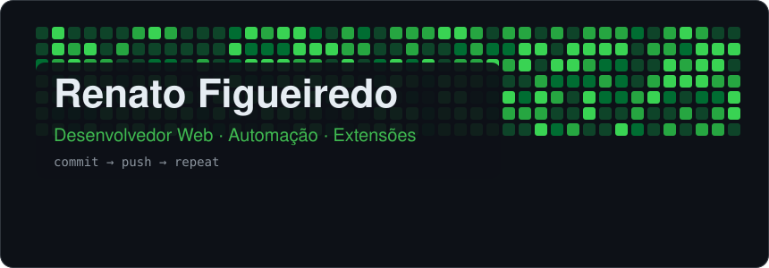
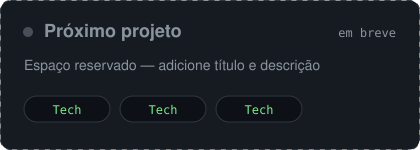

<!-- Alternativas: assets/banner-wave.svg · assets/banner-terminal.svg -->

## 👋 Sobre mim

Desenvolvedor focado em soluções web eficientes e criativas, com experiência em sites institucionais e automação. Transformo ideias em produtos e estou sempre aprendendo.

## 🚀 Projetos em destaque

<table>
<tr>
<td width="50%"></td>
<td width="50%"></td>
</tr>
<tr>
<td width="50%"></td>
<td width="50%"></td>
</tr>
</table>

> **neoChronos** — v1.0.0 disponível, registro de horas via `storage`. Próxima fase: sincronização na nuvem com Firebase. [Ver release](https://github.com/renato-figueiredo/NeoChronos/releases/tag/v1.0.0)

Também criei extensões privadas de automação para ambientes corporativos.

## 🛠️ Stack

**Aprendendo:** `PHP` · `Laravel` · `MongoDB` · `GraphQL`

## ✨ Estatísticas

 

